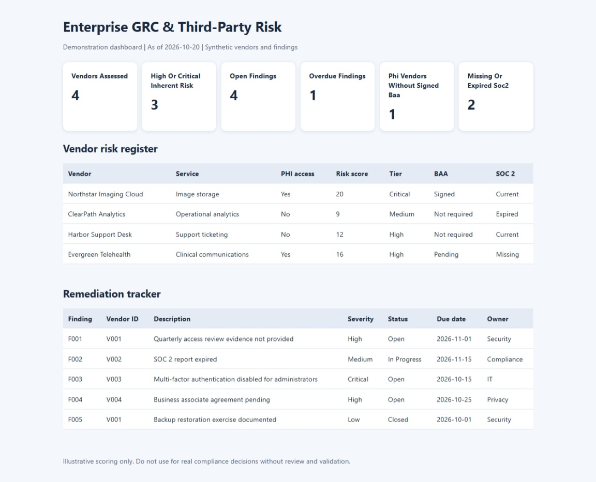

## GRC Risk Dashboard

The dashboard displays simulated vendor risk assessments, compliance evidence gaps, and remediation tracking for a fictional healthcare technology organization.



# Enterprise GRC & Third-Party Risk Management Program

**Portfolio project | Python automation | Vendor risk | NIST controls | Remediation tracking | Audit readiness**

A simulated governance, risk and compliance workflow for a fictional healthcare technology organization. Inspired by common security and third-party risk management responsibilities, not affiliated with any employer. **All vendors, evidence IDs, and findings are synthetic.**

## Features
- Third-party intake register with data classification, PHI access, business criticality, evidence status, and ownership
- Documented illustrative **5x5 inherent risk** scoring (likelihood × impact)
- Open/overdue remediation tracking and owner accountability
- Missing/expired SOC 2 evidence and unsigned BAA indicators
- Static HTML KPI dashboard and machine-readable JSON report
- Python standard-library implementation, unit tests, and GitHub Actions CI
- Sample vendor assessment questionnaire, control mapping, workflow and RACI

## Quick start
Requires Python 3.10+; no external dependencies.

```bash
python -m unittest discover -s tests -v
python src/grc.py --as-of 2026-10-19
```

Open `reports/dashboard.html` in a browser. Inspect `reports/risk_report.json` for structured output. The date is supplied explicitly so overdue metrics are reproducible.

## Sample metrics (as of 2026-10-19)
- 4 vendors assessed
- 3 high/critical inherent-risk vendors
- 4 open findings; 1 overdue
- 1 PHI-access vendor without signed BAA
- 2 vendors with missing or expired SOC 2 evidence

## Risk scoring
Scores 1–25 use `likelihood × impact` with tiers: Low 1–5, Medium 6–11, High 12–19, Critical 20–25. This is a **demonstration model**, not CVSS, a HIPAA requirement, or a validated residual-risk methodology. BAA and SOC 2 flags are tracked independently. Real programs need documented scope, data flow, evidence review, compensating controls and risk-owner sign-off.

## Repository structure
```
data/                 Synthetic vendor and finding registers
src/grc.py            Analysis, JSON reporting, HTML dashboard
reports/              Generated demonstration reports
tests/                Automated tests
docs/                 Questionnaire, control mapping, RACI, walkthrough
.github/workflows/    Continuous integration
```

## Security and privacy
Do not commit real PHI, PII, contracts, credentials, confidential audit evidence, vendor reports or proprietary risk findings. This sample dashboard is a local static file with no authentication and is not designed to host sensitive production data.


Project Summary description (only after personally reviewing and running the project)
**Enterprise GRC & Third-Party Risk Management Program — Portfolio Project:** Developed a Python-based simulated vendor-risk workflow to score inherent risk, track remediation and evidence gaps, and generate KPI dashboards and JSON reports; documented a third-party assessment questionnaire, NIST control mapping, and risk escalation process.
